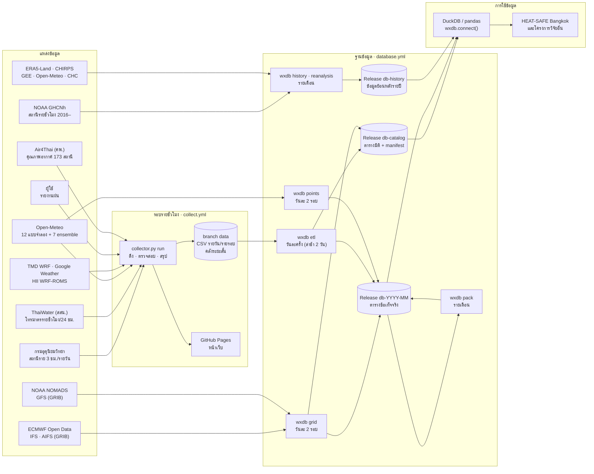
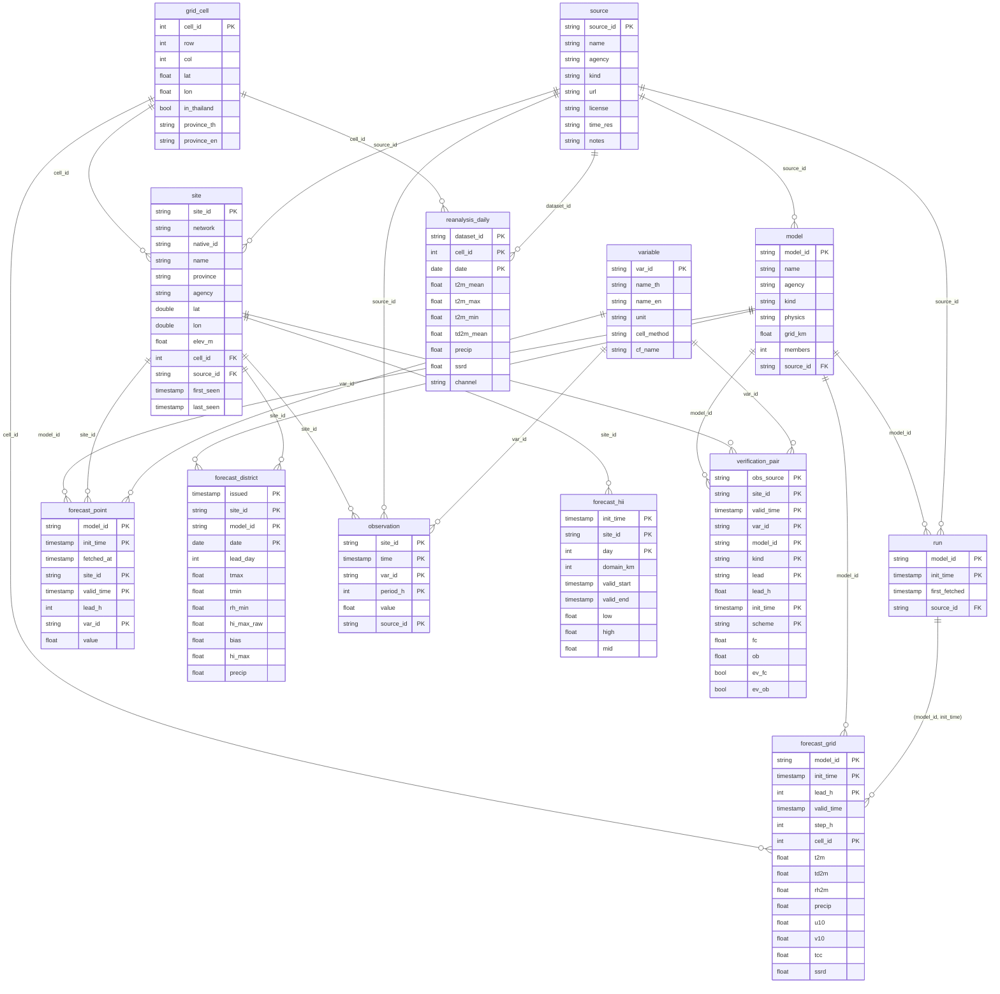

# ฐานข้อมูลอุตุนิยมวิทยาและแบบจำลองพยากรณ์อากาศของประเทศไทย (wxdb)

ฐานข้อมูลระยะยาวของระบบ Consolidated Weather รวบรวม **ค่าตรวจวัดจากสถานี**, **ผลพยากรณ์จากแบบจำลองหลายระบบ** และ **ผลการตรวจสอบความถูกต้อง** ครอบคลุมทั้งประเทศไทย มีโครงสร้างตาราง (schema) และความสัมพันธ์ที่กำหนดชัดเจน เพื่อใช้ซ้ำในงานวิจัยต่อเนื่องได้ ทุกองค์ประกอบใช้บริการที่ไม่มีค่าใช้จ่าย

| หัวข้อ | รายละเอียด |
|---|---|
| ขอบเขตเชิงพื้นที่ | ประเทศไทย: กริด th025 (0.25°, 957 เซลล์ ซึ่ง 694 เซลล์อยู่ในประเทศ), สถานีอุตุนิยมวิทยา ~128 แห่ง (GHCNh ~160), โทรมาตร ~4,300 เครื่อง, สถานีคุณภาพอากาศ 173 แห่ง, จุดตัวแทน 77 จังหวัดและ 50 เขตของกรุงเทพมหานคร |
| ขอบเขตเชิงเวลา | ค่าตรวจวัดรายชั่วโมง (GHCNh) และ ERA5-Land/CHIRPS รายวัน ตั้งแต่ 1 ม.ค. 2016 · ค่าตรวจวัดของหน่วยงานไทยและพยากรณ์ ณ จุด ตั้งแต่ 27 ก.ย. 2569 · พยากรณ์กริดตั้งแต่ 16 ต.ค. 2569 · ปรับปรุงอัตโนมัติทุกวัน |
| รูปแบบ | Apache Parquet (บีบอัด zstd) แบ่งไฟล์รายเดือน · เวลาเป็น UTC ทั้งหมด |
| ที่จัดเก็บ | GitHub Releases ของ repository นี้ (`db-catalog`, `db-YYYY-MM`, `db-history`) · ไม่มีค่าใช้จ่ายสำหรับ repository สาธารณะ |
| เครื่องมืออ่าน | DuckDB (SQL), pandas, pyarrow, R `arrow` หรือโปรแกรมใดที่อ่าน Parquet ได้ |
| ขนาดโดยประมาณ | ~1.3 GB/ปี (พยากรณ์กริด) + ~0.2 GB/ปี (ส่วนอื่น) · ข้อมูลย้อนหลัง 2016–2026 ~0.1 GB |

## 1. ขั้นตอนการไหลของข้อมูล (data flow)



| ขั้นตอน | ความถี่ | อินพุต | เอาต์พุต | โปรแกรม |
|---|---|---|---|---|
| เก็บข้อมูลรายชั่วโมง | ทุกชั่วโมง | API ของแหล่งข้อมูล | branch `data`, หน้าเว็บ | `collector.py run` |
| พยากรณ์กริด | 09:20 และ 21:20 UTC | GRIB ของ ECMWF/NOAA | `forecast_grid`, `run` | `python -m wxdb grid` |
| พยากรณ์ ณ สถานีอุตุนิยมวิทยาทุกแห่ง | 09:20 และ 21:20 UTC | Open-Meteo (10 แบบจำลอง) | `forecast_point` | `python -m wxdb points` |
| แปลงคลังรายชั่วโมง (ETL) | 21:20 UTC (วันที่ยังไม่ได้แปลงใน 7 วันล่าสุด) | branch `data` | `observation`, `forecast_point`, `forecast_hii`, `forecast_district`, `verification_pair`, `site`, `run` | `python -m wxdb etl` |
| รวมไฟล์รายเดือน | วันที่ 3 ของเดือน | ไฟล์รายวันของเดือนก่อน | `<table>__YYYY-MM.parquet` | `python -m wxdb pack` |
| ค่าตรวจวัดย้อนหลัง | วันที่ 3 ของเดือน (ปีปัจจุบัน) | NOAA GHCNh | `observation` (`db-history`) | `python -m wxdb history` |
| ข้อมูลย้อนหลังเชิงกริด | วันที่ 3 ของเดือน (3 เดือนล่าสุด) | ERA5-Land, CHIRPS | `reanalysis_daily` (`db-history`) | `python -m wxdb reanalysis` |
| ลดขนาดคลังระยะสั้น | วันที่ 3 ของเดือน | branch `data` | ลบ `runs/` ที่เก่ากว่า 35 วันและแปลงแล้ว แล้วยุบประวัติเหลือ commit เดียว | `python -m wxdb prune`, `scripts/squash_data.sh` |

หลักการ: branch `data` เป็น **คลังระยะสั้น** สำหรับหน้าเว็บและการตรวจสอบรายชั่วโมง ส่วน Releases เป็น **คลังระยะยาว** ที่มีโครงสร้างตาม schema ข้อมูลทุกแถวในคลังระยะยาวเป็น UTC มีหน่วยตามตาราง `variable` และอ้างอิงจุด/แบบจำลองผ่านคีย์

## 2. แผนภาพความสัมพันธ์ (ER diagram)

แบบจำลองดาว (star schema): ตารางมิติ (`source`, `model`, `variable`, `site`, `grid_cell`, `run`) อธิบายบริบท ส่วนตารางข้อเท็จจริง (`observation`, `forecast_*`, `verification_pair`) เก็บค่าและอ้างอิงมิติผ่านคีย์นอก ตาราง `site` เชื่อมกับ `grid_cell` ผ่าน `cell_id` ทำให้จับคู่ค่าตรวจวัดกับพยากรณ์กริดได้โดยตรง

<!-- ER_START -->

<!-- ER_END -->

## 3. ข้อกำหนดของข้อมูล

- **เวลา** ทุกคอลัมน์เป็น UTC (ไม่มีเขตเวลา) · เวลาไทย = UTC + 7 ชม.
- **ค่าสะสม** (ฝน, รังสี): ค่าของช่วง (เวลา − `period_h` หรือ `step_h`, เวลา] — เช่น ฝน `period_h = 24` ที่ `time = 00:00 UTC` คือฝนสะสม 07:00–07:00 น. ตามนิยามรายวันของกรมอุตุนิยมวิทยา
- **รหัสจุด** `site_id = <เครือข่าย>:<รหัสเดิม>` เช่น `tmd:48455` (สถานีกรุงเทพมหานคร), `tw:1` (โทรมาตร ThaiWater), `bkkdist:1001` (จุดตัวแทนเขตพระนคร), `loc:<lat>_<lon>` (ตำแหน่งที่กำหนดใน config), `user:<lat>_<lon>` (รายงานผู้ใช้ ปัดพิกัด 0.01°)
- **รอบพยากรณ์** `init_time` มาจาก metadata ของผู้ให้บริการ ข้อมูลก่อน ~29 ก.ย. 2569 ไม่มี metadata จึงใช้เวลาที่ดึงแทน
- **พยากรณ์ ณ จุด** (`forecast_point`) เก็บเฉพาะค่าแรกที่ได้รับของแต่ละรอบ ค่าที่ดึงซ้ำในรอบเดียวกันไม่เพิ่มสารสนเทศ
- **พยากรณ์กริด** (`forecast_grid`) ดึงจากไฟล์ GRIB ของศูนย์พยากรณ์โดยตรง (ไม่ผ่าน Open-Meteo) ใช้เซลล์ที่ตรงกับจุดกริดเดิมของแบบจำลอง (ไม่ประมาณค่าในช่วง) ค่าสะสมแปลงเป็นค่าของแต่ละช่วงด้วยนิยามเดียวกันทุกแบบจำลอง
- **การแก้ไขข้อมูล** ไฟล์ที่เผยแพร่แล้วไม่ถูกแก้ไข ยกเว้นการรวมรายเดือน ซึ่งตัดแถวซ้ำตามคีย์หลักโดยเก็บแถวแรก

## 4. การใช้งาน

### Python (DuckDB)

```python
import wxdb                                    # ต้องอยู่ในโฟลเดอร์ repository หรือติดตั้ง requirements-db.txt
con = wxdb.connect()                           # view ทุกตาราง อ่านจาก URL โดยตรง
con.sql("SELECT network, count(*) FROM site GROUP BY 1").df()

# MAE ของอุณหภูมิ ณ สถานีอุตุนิยมวิทยา: พยากรณ์กริด ECMWF IFS ล่วงหน้า 24 ชม. เทียบค่าตรวจวัดราย 3 ชม.
con.sql("""
  SELECT s.province, avg(abs(f.t2m - o.value)) AS mae, count(*) AS n
  FROM observation o
  JOIN site s USING (site_id)
  JOIN forecast_grid f ON f.cell_id = s.cell_id AND f.valid_time = o.time
  WHERE o.var_id = 't2m' AND s.network = 'tmd' AND f.model_id = 'ecmwf_ifs' AND f.lead_h = 24
  GROUP BY 1 ORDER BY 2
""").df()

# จำกัดเดือนและเก็บไฟล์ไว้ในเครื่องเพื่อใช้ซ้ำแบบออฟไลน์
con = wxdb.connect(months=["2026-10"], cache_dir="~/wxdb_cache")
```

### DuckDB CLI / R / เครื่องมืออื่น

URL ของทุกไฟล์อยู่ใน [`manifest.json`](https://github.com/Navavit/consolidated-weather/releases/download/db-catalog/manifest.json) (ฟิลด์ `files[].release` และ `files[].name`)

```sql
SELECT * FROM read_parquet('https://github.com/Navavit/consolidated-weather/releases/download/db-catalog/site.parquet');
```

### คำสั่งดูแลระบบ

```bash
pip install -r requirements.txt -r requirements-db.txt
python -m wxdb status                          # สรุปจำนวนแถว ขนาด และช่วงเวลาของแต่ละตาราง
python -m wxdb grid --days 3                   # ดึงพยากรณ์กริดที่ยังขาด
python -m wxdb etl --archive archive --from 2026-10-01 --to 2026-10-05
python -m wxdb pack --month 2026-10
python scripts/build_db_docs.py                # สร้าง ER และพจนานุกรมข้อมูลในเอกสารนี้ใหม่จาก wxdb/schema.py
```

## 5. พจนานุกรมข้อมูล (data dictionary)

ส่วนนี้สร้างอัตโนมัติจาก [`wxdb/schema.py`](../wxdb/schema.py) และ [`wxdb/catalog.py`](../wxdb/catalog.py)

<!-- DICT_START -->
### ตารางมิติ (release `db-catalog`)

#### `source`

แหล่งข้อมูล (หน่วยงาน บริการ หรือชุดข้อมูล) พร้อมสัญญาอนุญาต  
คีย์หลัก: `source_id`

| คอลัมน์ | ชนิด | คำอธิบาย |
|---|---|---|
| `source_id` | ข้อความ | รหัสแหล่งข้อมูล เช่น tmd, thaiwater, ecmwf_opendata |
| `name` | ข้อความ | ชื่อแหล่งข้อมูล |
| `agency` | ข้อความ | หน่วยงานผู้ผลิตข้อมูล |
| `kind` | ข้อความ | ประเภท: station_network | model_api | model_grib | model_image | reanalysis | satellite | crowd |
| `url` | ข้อความ | ที่อยู่บริการ |
| `license` | ข้อความ | สัญญาอนุญาต/เงื่อนไขการใช้ |
| `time_res` | ข้อความ | ความละเอียดเชิงเวลา |
| `notes` | ข้อความ | หมายเหตุ |

#### `model`

แบบจำลองพยากรณ์อากาศเชิงตัวเลข (NWP) แบบจำลองปัญญาประดิษฐ์ และระบบ ensemble  
คีย์หลัก: `model_id` · คีย์นอก: `source_id` → `source.source_id`

| คอลัมน์ | ชนิด | คำอธิบาย |
|---|---|---|
| `model_id` | ข้อความ | รหัสแบบจำลอง เช่น ecmwf_ifs |
| `name` | ข้อความ | ชื่อแบบจำลอง เช่น ECMWF IFS |
| `agency` | ข้อความ | หน่วยงานผู้พัฒนา |
| `kind` | ข้อความ | det (deterministic) | ens (ensemble) | regional |
| `physics` | ข้อความ | Physics | AI/ML |
| `grid_km` | ทศนิยม 32 บิต | ระยะห่างกริดโดยประมาณ (กม.) |
| `members` | จำนวนเต็ม | จำนวนสมาชิก ensemble (det = 1) |
| `source_id` | ข้อความ | ช่องทางที่ระบบนี้ใช้ดึงข้อมูล |

#### `variable`

ตัวแปรอุตุนิยมวิทยา หน่วย และวิธีสรุปค่าเชิงเวลา (CF cell_methods)  
คีย์หลัก: `var_id`

| คอลัมน์ | ชนิด | คำอธิบาย |
|---|---|---|
| `var_id` | ข้อความ | รหัสตัวแปร เช่น t2m, precip |
| `name_th` | ข้อความ | ชื่อภาษาไทย |
| `name_en` | ข้อความ | ชื่อภาษาอังกฤษ |
| `unit` | ข้อความ | หน่วย |
| `cell_method` | ข้อความ | point | sum | mean | max | min (ตลอดช่วง period_h) |
| `cf_name` | ข้อความ | CF standard name (ถ้ามี) |

#### `site`

จุดตรวจวัดหรือจุดพยากรณ์: สถานีอุตุนิยมวิทยา โทรมาตร จุดผู้ใช้ และจุดตัวแทนเขต  
คีย์หลัก: `site_id` · คีย์นอก: `source_id` → `source.source_id`, `cell_id` → `grid_cell.cell_id`

| คอลัมน์ | ชนิด | คำอธิบาย |
|---|---|---|
| `site_id` | ข้อความ | รหัสจุด <เครือข่าย>:<รหัสเดิม> เช่น tmd:48455, tw:1, bkkdist:1001 |
| `network` | ข้อความ | เครือข่าย: tmd | tw | air4thai | ghcnh | user | bkkdist | prov | loc |
| `native_id` | ข้อความ | รหัสจุดของหน่วยงานต้นทาง |
| `name` | ข้อความ | ชื่อจุด |
| `province` | ข้อความ | จังหวัด |
| `agency` | ข้อความ | หน่วยงานเจ้าของจุด |
| `lat` | ทศนิยม 64 บิต | ละติจูด (WGS84) |
| `lon` | ทศนิยม 64 บิต | ลองจิจูด (WGS84) |
| `elev_m` | ทศนิยม 32 บิต | ความสูงจากระดับทะเล (ม.) |
| `cell_id` | จำนวนเต็ม | เซลล์กริด th025 ที่ใกล้ที่สุด (เชื่อมค่าตรวจวัดกับพยากรณ์กริด) |
| `source_id` | ข้อความ | แหล่งข้อมูลของจุด |
| `first_seen` | เวลา (UTC) | เวลาที่พบในระบบครั้งแรก (UTC) |
| `last_seen` | เวลา (UTC) | เวลาที่พบในระบบล่าสุด (UTC) |

#### `grid_cell`

เซลล์ของกริด th025 (0.25°) ครอบคลุมประเทศไทยและแนวกันชน 0.25°  
คีย์หลัก: `cell_id`

| คอลัมน์ | ชนิด | คำอธิบาย |
|---|---|---|
| `cell_id` | จำนวนเต็ม | row × 37 + col ในกรอบ 21°N–5°N, 97°E–106°E |
| `row` | จำนวนเต็ม | แถว (0 = 21°N) |
| `col` | จำนวนเต็ม | คอลัมน์ (0 = 97°E) |
| `lat` | ทศนิยม 32 บิต | ละติจูดจุดศูนย์กลาง |
| `lon` | ทศนิยม 32 บิต | ลองจิจูดจุดศูนย์กลาง |
| `in_thailand` | จริง/เท็จ | จุดศูนย์กลางอยู่ภายในประเทศไทย |
| `province_th` | ข้อความ | จังหวัด (หรือจังหวัดที่ใกล้ที่สุด) |
| `province_en` | ข้อความ | จังหวัด (อังกฤษ) |

#### `run`

รอบการประมวลผลของแบบจำลอง (forecast cycle) ที่ระบบได้รับ  
คีย์หลัก: `model_id, init_time` · คีย์นอก: `model_id` → `model.model_id`, `source_id` → `source.source_id`

| คอลัมน์ | ชนิด | คำอธิบาย |
|---|---|---|
| `model_id` | ข้อความ | แบบจำลอง |
| `init_time` | เวลา (UTC) | เวลาเริ่มต้นของรอบ (UTC) |
| `first_fetched` | เวลา (UTC) | เวลาที่ระบบได้รับรอบนี้ครั้งแรก (UTC) — ใช้ประเมินความล่าช้าในการเผยแพร่ |
| `source_id` | ข้อความ | ช่องทางที่ได้รับ |

### ตารางข้อเท็จจริง (release `db-YYYY-MM`)

#### `forecast_grid`

พยากรณ์บนกริด th025 จากไฟล์ GRIB ของศูนย์พยากรณ์ (รอบ 00/12 UTC, ล่วงหน้า 0–168 ชม.)  
คีย์หลัก: `model_id, init_time, lead_h, cell_id` · คีย์นอก: `model_id` → `model.model_id`, `cell_id` → `grid_cell.cell_id`, `(model_id, init_time)` → `run.(model_id, init_time)`

| คอลัมน์ | ชนิด | คำอธิบาย |
|---|---|---|
| `model_id` | ข้อความ | แบบจำลอง |
| `init_time` | เวลา (UTC) | เวลาเริ่มต้นของรอบ (UTC) |
| `lead_h` | จำนวนเต็ม | ระยะล่วงหน้า (ชม.) |
| `valid_time` | เวลา (UTC) | เวลาที่พยากรณ์ (UTC) = init_time + lead_h |
| `step_h` | จำนวนเต็ม | ช่วงสะสมของ precip และ ssrd (ชม.) — 3 หรือ 6 |
| `cell_id` | จำนวนเต็ม | เซลล์กริด |
| `t2m` | ทศนิยม 32 บิต | อุณหภูมิอากาศที่ 2 ม. (°C) |
| `td2m` | ทศนิยม 32 บิต | อุณหภูมิจุดน้ำค้างที่ 2 ม. (°C) |
| `rh2m` | ทศนิยม 32 บิต | ความชื้นสัมพัทธ์ที่ 2 ม. (%) |
| `precip` | ทศนิยม 32 บิต | ฝนสะสมในช่วง step_h ชม. ก่อน valid_time (มม.) |
| `u10` | ทศนิยม 32 บิต | ลมองค์ประกอบตะวันออก–ตะวันตกที่ 10 ม. (ม./วินาที) |
| `v10` | ทศนิยม 32 บิต | ลมองค์ประกอบเหนือ–ใต้ที่ 10 ม. (ม./วินาที) |
| `tcc` | ทศนิยม 32 บิต | เมฆปกคลุมทั้งหมด (%) |
| `ssrd` | ทศนิยม 32 บิต | รังสีคลื่นสั้นขาลงที่ผิวโลก เฉลี่ยในช่วง step_h (W/m²) |

#### `forecast_point`

พยากรณ์รายชั่วโมง ณ จุด จาก Open-Meteo / TMD WRF / Google (เก็บค่าแรกที่ได้รับของแต่ละรอบ)  
คีย์หลัก: `model_id, init_time, site_id, valid_time, var_id` · คีย์นอก: `model_id` → `model.model_id`, `site_id` → `site.site_id`, `var_id` → `variable.var_id`

| คอลัมน์ | ชนิด | คำอธิบาย |
|---|---|---|
| `model_id` | ข้อความ | แบบจำลอง |
| `init_time` | เวลา (UTC) | เวลาเริ่มต้นของรอบ (UTC; ประมาณจาก metadata เมื่อแหล่งไม่ระบุ) |
| `fetched_at` | เวลา (UTC) | เวลาที่ดึงข้อมูล (UTC) |
| `site_id` | ข้อความ | จุด |
| `valid_time` | เวลา (UTC) | เวลาที่พยากรณ์ (UTC; สิ้นสุดช่วงสะสม) |
| `lead_h` | จำนวนเต็ม | ระยะล่วงหน้า (ชม.) |
| `var_id` | ข้อความ | ตัวแปร |
| `value` | ทศนิยม 32 บิต | ค่า (หน่วยตาม variable) |

#### `forecast_district`

พยากรณ์รายวันต่อแบบจำลองรายพื้นที่ (ออกวันละครั้งหลัง 07:00 น.): เขตของกรุงเทพมหานคร (ปรับแก้ความเอนเอียงของ HI) และ 77 จังหวัด (ไม่ปรับแก้)  
คีย์หลัก: `issued, site_id, model_id, date` · คีย์นอก: `model_id` → `model.model_id`, `site_id` → `site.site_id`

| คอลัมน์ | ชนิด | คำอธิบาย |
|---|---|---|
| `issued` | เวลา (UTC) | เวลาออกพยากรณ์ (UTC) |
| `site_id` | ข้อความ | จุดตัวแทนพื้นที่ (bkkdist:<รหัสเขต> หรือ prov:<รหัส ISO 3166-2>) |
| `model_id` | ข้อความ | แบบจำลอง |
| `date` | วันที่ | วันที่ (เวลาไทย) |
| `lead_day` | จำนวนเต็ม | ระยะล่วงหน้า (วัน) |
| `tmax` | ทศนิยม 32 บิต | อุณหภูมิสูงสุด (°C) |
| `tmin` | ทศนิยม 32 บิต | อุณหภูมิต่ำสุด (°C) |
| `rh_min` | ทศนิยม 32 บิต | ความชื้นสัมพัทธ์ต่ำสุด (%) |
| `hi_max_raw` | ทศนิยม 32 บิต | ดัชนีความร้อนสูงสุดก่อนปรับแก้ (°C) |
| `bias` | ทศนิยม 32 บิต | ความเอนเอียงที่ใช้ปรับแก้ (°C) |
| `hi_max` | ทศนิยม 32 บิต | ดัชนีความร้อนสูงสุดหลังปรับแก้ (°C) |
| `precip` | ทศนิยม 32 บิต | ฝนรวมรายวัน (มม.) |

#### `observation`

ค่าตรวจวัดจากสถานีและรายงานของผู้ใช้  
คีย์หลัก: `site_id, time, var_id, period_h, source_id` · คีย์นอก: `site_id` → `site.site_id`, `var_id` → `variable.var_id`, `source_id` → `source.source_id`

| คอลัมน์ | ชนิด | คำอธิบาย |
|---|---|---|
| `site_id` | ข้อความ | จุดตรวจวัด |
| `time` | เวลา (UTC) | เวลาตรวจวัด (UTC; สิ้นสุดช่วงสะสม) |
| `var_id` | ข้อความ | ตัวแปร |
| `period_h` | จำนวนเต็ม | ช่วงสะสม/สรุป (ชม.); 0 = ค่า ณ เวลา |
| `value` | ทศนิยม 32 บิต | ค่า |
| `source_id` | ข้อความ | แหล่ง/บริการที่ให้ค่า |

#### `forecast_hii`

พยากรณ์ฝนรายวัน HII WRF-ROMS (สสน.) อ่านจากภาพ: ช่วงฝนตามแถบสี  
คีย์หลัก: `init_time, site_id, day` · คีย์นอก: `site_id` → `site.site_id`

| คอลัมน์ | ชนิด | คำอธิบาย |
|---|---|---|
| `init_time` | เวลา (UTC) | เวลาเริ่มต้นของรอบ (UTC) |
| `site_id` | ข้อความ | จุด |
| `day` | จำนวนเต็ม | วันล่วงหน้า (1 = 19:00–19:00 น. ถัดไป) |
| `domain_km` | จำนวนเต็ม | ความละเอียดโดเมน (กม.) |
| `valid_start` | เวลา (UTC) | ต้นช่วง (UTC) |
| `valid_end` | เวลา (UTC) | ปลายช่วง (UTC) |
| `low` | ทศนิยม 32 บิต | ขอบล่างของช่วงฝน (มม.) |
| `high` | ทศนิยม 32 บิต | ขอบบนของช่วงฝน (มม.) |
| `mid` | ทศนิยม 32 บิต | ค่ากลางของช่วงฝน (มม.) |

#### `verification_pair`

คู่ค่าพยากรณ์–ค่าตรวจวัดที่จับคู่แล้วตามเกณฑ์ WMO (ใช้คำนวณคะแนน MAE, RMSE, CSI, Brier ฯลฯ)  
คีย์หลัก: `obs_source, site_id, valid_time, var_id, model_id, kind, lead, init_time, scheme` · คีย์นอก: `site_id` → `site.site_id`, `var_id` → `variable.var_id`, `model_id` → `model.model_id`

| คอลัมน์ | ชนิด | คำอธิบาย |
|---|---|---|
| `obs_source` | ข้อความ | ชุดค่าตรวจวัดที่ใช้: tmd3h | tmdday | tw24h | hii24h | user |
| `site_id` | ข้อความ | จุดตรวจวัด |
| `valid_time` | เวลา (UTC) | เวลาสิ้นสุดช่วงตรวจวัด (UTC) |
| `var_id` | ข้อความ | ตัวแปร |
| `model_id` | ข้อความ | แบบจำลอง |
| `kind` | ข้อความ | det | ens |
| `lead` | ข้อความ | ระยะล่วงหน้าที่รายงาน เช่น H24, D+1 |
| `lead_h` | ทศนิยม 32 บิต | ระยะล่วงหน้าจริง (ชม. จาก init_time ถึงกลางช่วง) |
| `init_time` | เวลา (UTC) | เวลาเริ่มต้นของรอบ (UTC) |
| `scheme` | ข้อความ | วิธีจับคู่ |
| `fc` | ทศนิยม 32 บิต | ค่าพยากรณ์ |
| `ob` | ทศนิยม 32 บิต | ค่าตรวจวัด |
| `ev_fc` | จริง/เท็จ | พยากรณ์ว่าเกิดเหตุการณ์ (ฝน ≥ เกณฑ์) |
| `ev_ob` | จริง/เท็จ | เกิดเหตุการณ์จริง |

#### `reanalysis_daily`

ข้อมูลย้อนหลังเชิงกริดรายวัน (วัน UTC) ณ จุดศูนย์กลางเซลล์ th025: ERA5-Land และ CHIRPS ตั้งแต่ปี 2016  
คีย์หลัก: `dataset_id, cell_id, date` · คีย์นอก: `dataset_id` → `source.source_id`, `cell_id` → `grid_cell.cell_id`

| คอลัมน์ | ชนิด | คำอธิบาย |
|---|---|---|
| `dataset_id` | ข้อความ | ชุดข้อมูล: era5_land | chirps |
| `cell_id` | จำนวนเต็ม | เซลล์กริด th025 |
| `date` | วันที่ | วันที่ (UTC 00–24) |
| `t2m_mean` | ทศนิยม 32 บิต | อุณหภูมิเฉลี่ยรายวัน (°C) |
| `t2m_max` | ทศนิยม 32 บิต | อุณหภูมิสูงสุด (°C) |
| `t2m_min` | ทศนิยม 32 บิต | อุณหภูมิต่ำสุด (°C) |
| `td2m_mean` | ทศนิยม 32 บิต | จุดน้ำค้างเฉลี่ย (°C) |
| `precip` | ทศนิยม 32 บิต | ฝนรวมรายวัน (มม.) |
| `ssrd` | ทศนิยม 32 บิต | รังสีคลื่นสั้นขาลงรวมรายวัน (MJ/m²) |
| `channel` | ข้อความ | ช่องทางที่ดึง: gee | openmeteo | chc |

### รหัสตัวแปร (`variable`)

| var_id | ชื่อ | หน่วย | วิธีสรุปค่า |
|---|---|---|---|
| `t2m` | อุณหภูมิอากาศ 2 ม. | °C | point |
| `td2m` | อุณหภูมิจุดน้ำค้าง 2 ม. | °C | point |
| `rh2m` | ความชื้นสัมพัทธ์ 2 ม. | % | point |
| `tmax` | อุณหภูมิสูงสุด | °C | max |
| `tmin` | อุณหภูมิต่ำสุด | °C | min |
| `precip` | ปริมาณฝน | มม. | sum |
| `precip_prob` | ความน่าจะเป็นฝน (สัดส่วนสมาชิก ensemble ที่ฝน ≥ เกณฑ์) | % | point |
| `rain_flag` | มีฝน (รายงานผู้ใช้) | 0/1 | point |
| `wind_speed` | ความเร็วลม 10 ม. | ม./วินาที | point |
| `wind_dir` | ทิศทางลม 10 ม. | องศา | point |
| `wind_gust` | ลมกระโชก | ม./วินาที | max |
| `u10` | ลมองค์ประกอบตะวันออก 10 ม. | ม./วินาที | point |
| `v10` | ลมองค์ประกอบเหนือ 10 ม. | ม./วินาที | point |
| `mslp` | ความกดอากาศระดับน้ำทะเล | hPa | point |
| `visibility` | ทัศนวิสัย | กม. | point |
| `tcc` | เมฆปกคลุมทั้งหมด | % | point |
| `ssrd` | รังสีคลื่นสั้นขาลงที่ผิวโลก | W/m² | mean |
| `pm25` | ฝุ่นละอองขนาดไม่เกิน 2.5 ไมครอน | µg/m³ | mean |
| `pm10` | ฝุ่นละอองขนาดไม่เกิน 10 ไมครอน | µg/m³ | mean |
| `o3` | โอโซน | ppb | mean |
| `co` | คาร์บอนมอนอกไซด์ | ppm | mean |
| `no2` | ไนโตรเจนไดออกไซด์ | ppb | mean |
| `so2` | ซัลเฟอร์ไดออกไซด์ | ppb | mean |
| `aqi` | ดัชนีคุณภาพอากาศ (AQI ของประเทศไทย) |  | point |

### แหล่งข้อมูล (`source`)

| source_id | แหล่งข้อมูล | หน่วยงาน | ประเภท | สัญญาอนุญาต |
|---|---|---|---|---|
| `tmd` | [TMD Weather3Hours / WeatherToday](https://data.tmd.go.th/api/) | กรมอุตุนิยมวิทยา | station_network | TMD Open Data |
| `thaiwater` | [ThaiWater (คลังข้อมูลน้ำแห่งชาติ)](https://www.thaiwater.net/) | สถาบันสารสนเทศทรัพยากรน้ำ (สสน.) | station_network | เปิดเผยตามเงื่อนไขของ สสน. |
| `air4thai` | [Air4Thai](http://air4thai.pcd.go.th/) | กรมควบคุมมลพิษ | station_network | เปิดเผย |
| `noaa_ghcnh` | [NOAA Global Historical Climatology Network – hourly (GHCNh)](https://www.ncei.noaa.gov/products/global-historical-climatology-network-hourly) | NOAA NCEI | station_network | สาธารณสมบัติ (US Gov) |
| `user` | รายงานฝนจากผู้ใช้ | ผู้ใช้ระบบ (GitHub Issues) | crowd | CC BY 4.0 |
| `openmeteo` | [Open-Meteo Forecast / Ensemble API](https://open-meteo.com/) | Open-Meteo (รวบรวมจากศูนย์พยากรณ์) | model_api | CC BY 4.0 (ใช้งานไม่เชิงพาณิชย์ ≤ 10,000 คำขอ/วัน) |
| `tmd_nwp` | [TMD NWP API (WRF)](https://data.tmd.go.th/nwpapi/) | กรมอุตุนิยมวิทยา | model_api | TMD Open Data |
| `google_weather` | [Google Weather API](https://developers.google.com/maps/documentation/weather) | Google Maps Platform | model_api | ตามเงื่อนไข Google (โควตาฟรี) |
| `hii_image` | [ThaiWater ภาพพยากรณ์ฝน WRF-ROMS](https://www.thaiwater.net/weather) | สสน. | model_image | เปิดเผย |
| `ecmwf_opendata` | [ECMWF Open Data](https://data.ecmwf.int/forecasts/) | ECMWF | model_grib | CC BY 4.0 |
| `noaa_nomads` | [NOAA NOMADS GRIB filter](https://nomads.ncep.noaa.gov/) | NOAA NCEP | model_grib | สาธารณสมบัติ (US Gov) |
| `era5_land` | [ERA5-Land](https://cds.climate.copernicus.eu/datasets/reanalysis-era5-land) | ECMWF / Copernicus Climate Change Service | reanalysis | Copernicus licence (อ้างอิงแหล่งที่มา) |
| `chirps` | [CHIRPS v2.0](https://www.chc.ucsb.edu/data/chirps) | UCSB Climate Hazards Center | satellite | CC BY 4.0 |
| `heatsafe` | พยากรณ์ภัยความร้อนรายเขต (weather_heatsafe.py) | Consolidated Weather | model_api | CC BY 4.0 |
<!-- DICT_END -->

## 6. ข้อจำกัดและแผนการพัฒนา

- **API ของกรมอุตุนิยมวิทยาให้เฉพาะค่าล่าสุด** ค่าตรวจวัดราย 3 ชม. ที่รอบเก็บข้อมูลพลาด (เช่น GitHub Actions ล่าช้าเกิน 3 ชม.) จะดึงย้อนหลังไม่ได้
- **ค่าตรวจวัดย้อนหลัง** ใช้ NOAA GHCNh ซึ่ง NOAA ใช้แทน ISD/GSOD (หยุดปรับปรุง ส.ค. 2568) ค่าของสถานีเดียวกันอาจมีทั้งจาก `tmd` (API ของกรมอุตุนิยมวิทยา) และ `noaa_ghcnh` ในเวลาเดียวกัน ควรเลือก `source_id` ให้ชัดเจนเมื่อวิเคราะห์ · สถานีที่ไม่มีรหัส WMO ใช้ `site_id = ghcnh:<ID>`
- **ERA5-Land/CHIRPS** เป็นค่าของเซลล์ต้นทาง (0.1° และ 0.05°) ที่ครอบจุดศูนย์กลางเซลล์ th025 ไม่ใช่ค่าเฉลี่ยทั้งเซลล์ 0.25° · เซลล์เหนือทะเลไม่มีค่า ERA5-Land · ค่ารายเดือนจาก Open-Meteo ใช้ฝนและรังสีของ ERA5 (ERA5-Land ใช้ฝนและรังสีของ ERA5 เป็นข้อมูลขับเคลื่อน) ค่าจาก GEE (ช่วงย้อนหลัง) มีลำดับความสำคัญสูงกว่าเมื่อมีทั้งสองช่องทาง (คอลัมน์ `channel`)
- **Air4Thai** ช่วงเฉลี่ยตามนิยามดัชนีคุณภาพอากาศของกรมควบคุมมลพิษ: PM2.5/PM10 24 ชม., O3/CO 8 ชม., NO2/SO2 1 ชม. (`period_h`) · เก็บตั้งแต่ 18 ต.ค. 2569
- **พยากรณ์ ณ สถานีอุตุนิยมวิทยา** (`wxdb points`) เก็บเฉพาะชั่วโมงตั้งแต่เวลาที่ดึง เนื่องจาก Open-Meteo เติมชั่วโมงก่อนหน้าด้วยผลของรอบก่อน
- **สัญญาอนุญาต** ข้อมูลแต่ละแหล่งอยู่ภายใต้เงื่อนไขของผู้ผลิต (ตาราง `source`) — การเผยแพร่ต่อควรอ้างอิงแหล่งที่มาตามนั้น
